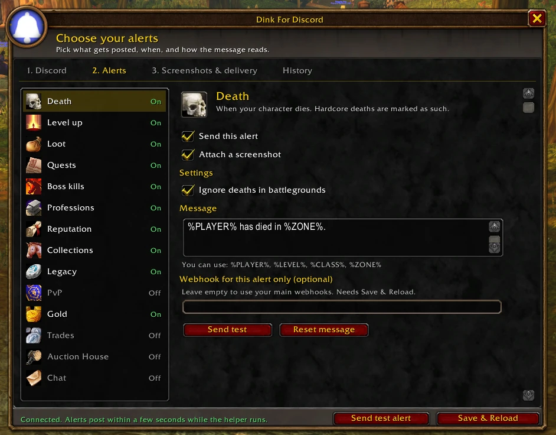

# Dink For Discord

A World of Warcraft: Forever addon (plus a small Windows helper) that posts deaths, level ups, loot, boss kills and more to Discord with screenshots. Inspired by the Dink plugin for RuneLite. Not affiliated with the Dink project or Blizzard.



## Install

1. Install the addon from CurseForge (or copy the `DinkForDiscord` folder into `World of Warcraft/_forever_/Interface/AddOns`).
2. Download `DinkHelper.exe` from [Releases](https://github.com/koso313/dink-for-discord/releases/latest), unzip, double-click. A bell appears in your tray.
3. In Discord: Server Settings > Integrations > Webhooks > New Webhook > Copy Webhook URL.
4. In game: `/dink`, paste the URL, click **Save & Reload**, then **Send test alert**.

Addons can't use the internet, which is why the helper exists. It only reads your Screenshots folder and the addon's saved settings, and only posts to discord.com webhooks. It never touches the game itself.

## Layout

| Folder | What |
|---|---|
| `DinkForDiscord/` | The addon (this folder is what goes in `Interface/AddOns` and on CurseForge) |
| `Helper/DinkHelper/` | The Windows tray helper (C#, .NET Framework 4.8, no install needed) |
| `tests/` | Runs the addon in a fake WoW client and the helper against a fake Discord |
| `tools/` | `package.py` (build, test, zip, install), `make_icons.py` |
| `curseforge/` | Project page text and logo |
| `dist/` | Built zips |

## How it works

Addons can't use the internet, so:

1. The addon detects an event, builds the alert (message, fields, colour) and saves it in `DinkForDiscordDB.outbox`.
2. It takes a normal screenshot (if wanted), then draws a data code in the top-left corner and takes a second screenshot.
3. The helper watches `_forever_/Screenshots`, decodes the data code (`StripDecoder.cs`), posts to Discord with the normal screenshot, and deletes the data screenshot.
4. It also reads `WTF/Account/*/SavedVariables/DinkForDiscord.lua` for the webhooks and posts anything from the outbox it missed (last 24 hours). Alert ids stop duplicates.

Data code format (`Strip.lua` and `StripDecoder.cs` must match): 64 square cells per row, cell = max(6, screen height / 180) pixels; row 0 is red, green, blue, white, then black/white alternating; data rows carry 3 bits per cell (R=4, G=2, B=1). Bytes: `D K version lenHi lenLo payload adler32`. Decodes reliably down to JPEG quality 20.

## Build and test

```bash
python tools/package.py --install
```

Builds the helper, runs all tests (`tests/run_tests.py`, needs `pip install lupa pillow`), writes `dist/` zips and copies the addon into WoW Forever.

## Releasing

1. Bump `## Version` in `DinkForDiscord/DinkForDiscord.toc` and `<Version>` in `Helper/DinkHelper/DinkHelper.csproj`.
2. `python tools/package.py`
3. Upload `dist/DinkForDiscord-<version>.zip` to CurseForge (game version: WoW Forever 1.60.1). Project page: text from `curseforge/description.md`, logo `curseforge/logo.png`, and the pictures in `curseforge/screenshots/` under Images. Blur any webhook URL in new screenshots before uploading.
4. Attach `dist/DinkForDiscordHelper-<version>.zip` to a GitHub release and link it from the CurseForge page.
